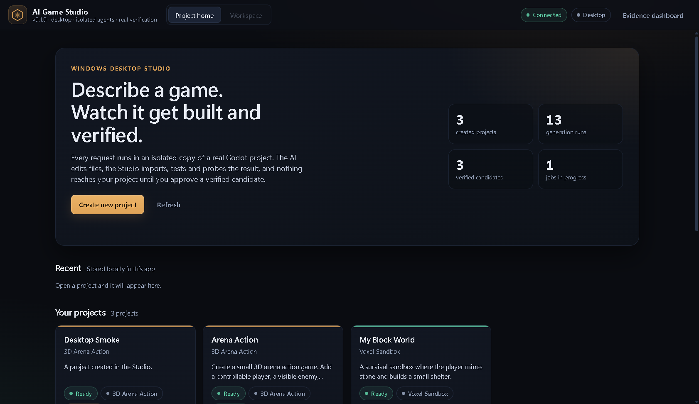
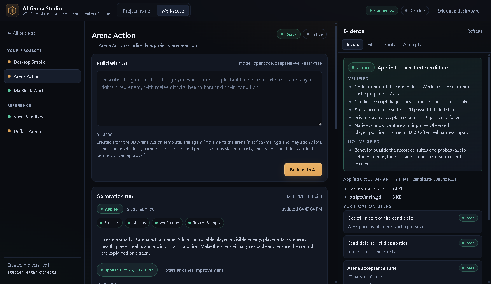
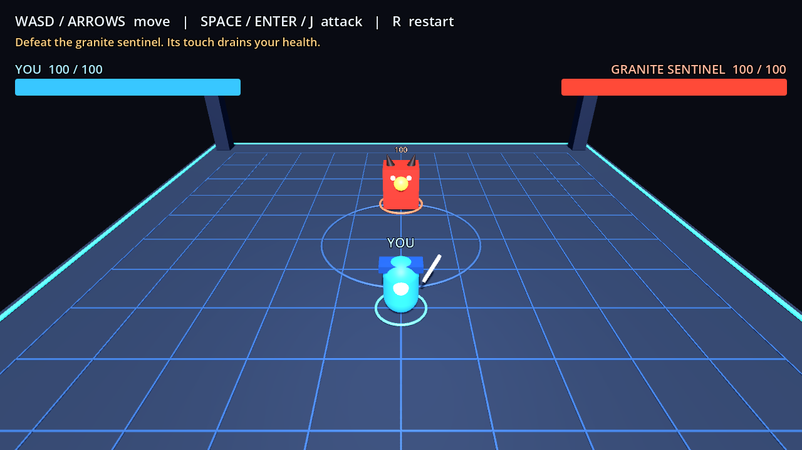
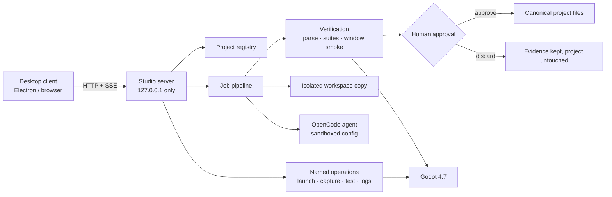

# AI Game Studio

A local Windows desktop app that turns a plain-language game description into a
real, verified Godot project — and refuses to touch your project until you
approve the result.

Type a description, an AI agent edits an **isolated copy** of a game project, the
Studio independently re-imports, parses, tests and plays the candidate in a real
Godot window, and the diff, screenshots and test output are shown side by side.
Approval re-checks the workspace and canonical file hashes before writing
anything.



| Workspace + evidence | The game the agent built |
| --- | --- |
|  |  |

The screenshots are real captures from this repository's verification runs: the
desktop home with created projects and runs, the workspace showing a verified
candidate, and the 1280×720 frame captured from the Godot game the agent
produced.

## Why

AI can write game code faster than a person can review it, but "the model said it
works" is not evidence. This project explores the other half of the problem: an
agent loop with **independent verification** and a **human gate**, where every
claim in the UI is backed by a file that was actually run.

The repository also contains the engine and Godot harness the Studio drives —
both were built and verified phase by phase before the desktop app existed.

## What is actually implemented

Verified by the test suites and by real runs recorded in
[`studio/VERIFICATION-REPORT.md`](studio/VERIFICATION-REPORT.md):

**Studio backend** (`studio/server/`)

- Loopback-only HTTP server (`127.0.0.1`) with a restrictive CSP, 64 KiB body
  cap and path containment on every filesystem access.
- Project registry with two implemented templates (**Voxel Sandbox**, **3D Arena
  Action**), validated creation, staged rename, and a real
  `godot --headless --import` step. Failed imports are reported as
  `needs_import`, never faked.
- Job pipeline: baseline → AI edit → scope policy → verification → bounded
  repair → human decision. Job state, attempts, transcripts, diffs and artifacts
  are append-only on disk.
- Independent verification: GDScript parse, the project's visible suite, a
  **pristine** copy of the same suite from outside the project, and a native
  windowed smoke run that asserts an observed `player_position` change.
- Approval applies only allowed modified/added files, after re-hashing the
  workspace and the canonical files. Discard leaves the project untouched and
  keeps the evidence.

**Desktop app** (`studio/desktop/`, `studio/public/desktop.*`)

- Electron 45 shell that starts the existing server **in-process** on an
  OS-assigned port, with a single-instance lock (a second launch focuses the
  first window instead of starting a second backend).
- Project home, AI workspace, viewport (launch / capture / run suite / logs),
  and an evidence panel that keeps *verified* and *not verified* claims apart.
- Sandboxed preload bridge; loopback-only navigation guard; clean shutdown.

**Packaging**

- `npm run package:win` produces a portable, unsigned
  `desktop-dist\AI Game Studio-win32-x64\AI Game Studio.exe` (~409 MB) that runs
  without Node.js installed.

**Engine and harness** (documented in [`ENGINE.md`](ENGINE.md))

- A text-first THREE.js engine with a deterministic render/capture loop, a
  versioned scene document, physics, cameras and hot reload.
- A Godot 4.7 control/verification harness: headless test runs, state
  inspection, screenshot capture, native window input, physics queries, GDScript
  LSP checks and a supervisor.

## Architecture



| Component | Responsibility |
| --- | --- |
| `studio/server/index.mjs` | HTTP routes, SSE, security headers, `/app` desktop routes |
| `studio/server/lib/projects.mjs` | Registry, templates, creation, disk discovery |
| `studio/server/lib/agent-runner.mjs` | Job state machine, agent invocation, repair, approval |
| `studio/server/lib/workspace.mjs` | Isolated copy, tree diff, scope policy, unified diff |
| `studio/server/lib/verification.mjs` | Independent verification steps |
| `studio/server/lib/operations.mjs` | Fixed op set (`launch`, `capture`, `test`, …) |
| `studio/server/lib/process.mjs` | Timeouts, output caps, child-process supervision |
| `studio/desktop/main.mjs` | Electron host, in-process server, single instance, shutdown |
| `studio/public/desktop.*` | Desktop UI (plain HTML/CSS/JS, no framework) |
| `experiments/godot-harness/` | Godot control + verification harness used by the Studio |
| `src/`, `index.html` | THREE.js engine (Phases 0–5) — see `ENGINE.md` |

## Tech stack

| Layer | Technology |
| --- | --- |
| Desktop shell | Electron 45, `@electron/packager` 18 |
| Studio backend | Node.js ≥ 20, ESM, `node:http`, no runtime dependencies |
| Studio UI | Plain HTML/CSS/JS, server-sent events |
| AI agent | [OpenCode CLI](https://opencode.ai), sandboxed per run (read/write/edit/glob/grep only) |
| Game engine | Godot 4.7 (GDScript), driven headless and in a native window |
| Engine (Phases 0–5) | TypeScript, Vite, three.js, Zod |
| Tests | `node:test`, Python `pytest` + `pywin32` for native-window automation |

## Requirements

- **Windows 10/11 x64** for the desktop app, native-window automation and
  packaging. The Studio server and browser UI are cross-platform; the Godot
  harness falls back to `godot` on `PATH` elsewhere.
- **Node.js 20+**.
- **Godot 4.7** — put the `godot` shim on `PATH`, or set `GODOT_BIN` to the
  executable. Without it, projects can be created but not imported, launched or
  verified, and the UI says so.
- **OpenCode CLI** for AI generation runs. The harness resolves it from
  `OPENCODE_BIN` or its default install location. Tests, launch and capture work
  without it.

No `.env` file is used or needed: the server reads environment variables
directly (see [Configuration](#configuration)).

## Quick start

```powershell
# 1. Studio (browser UI + backend)
Set-Location studio
npm install          # first run only: Electron + packager dev dependencies
npm start
# -> http://127.0.0.1:8787/        read-only Phase 19 evidence dashboard
# -> http://127.0.0.1:8787/studio  full Studio UI
# -> http://127.0.0.1:8787/app     desktop UI in a browser

# 2. Desktop app (starts its own backend in-process)
npm run desktop

# 3. Portable Windows build
npm run package:win
# -> desktop-dist\AI Game Studio-win32-x64\AI Game Studio.exe
```

`npm run desktop:attach` attaches Electron to an already running `npm start`
(`STUDIO_URL`), and `npm run desktop:dev` enables DevTools.

The engine (Phases 0–5) runs separately:

```powershell
npm ci
npm run dev          # http://localhost:5173/
```

## Tests and checks

```powershell
# Studio backend + desktop (140 tests)
Set-Location studio
npm test

# Godot harness (84 tests)
Set-Location ..\experiments\godot-harness
npm test

# Native-window automation (Windows only, 12 tests)
python -m pytest tests/test_win_game.py -q

# GDScript parse/type diagnostics via the Godot LSP
npm run check:gd
```

Last recorded results on this machine: **140/140** Studio tests, **84/84**
harness tests, **12** pytest tests, `check:gd` **0 errors / 11 pre-existing
warnings**. The full evidence trail, including the exact commands and every real
job, is in [`studio/VERIFICATION-REPORT.md`](studio/VERIFICATION-REPORT.md).

## Configuration

| Variable | Default | Purpose |
| --- | --- | --- |
| `STUDIO_PORT` | `8787` | Loopback port. The host is fixed to `127.0.0.1`. |
| `STUDIO_AGENT_MODEL` | `opencode/deepseek-v4.1-flash-free` | Default model in the composer. |
| `STUDIO_AGENT_MODELS` | built-in list | Comma-separated allowlist of accepted models. |
| `STUDIO_URL` | — | Attach the desktop shell to an existing server instead of starting one. |
| `STUDIO_DEV` | — | `1` enables Electron DevTools and the dev menu. |
| `GODOT_BIN` | `godot` on `PATH` | Godot 4.7 executable used for import, tests and the windowed run. |
| `OPENCODE_BIN` | harness default | OpenCode CLI binary used for AI runs. |

## How a run works

1. **Describe** a change (or a whole arena game) in the workspace.
2. The Studio copies the project into a **disposable workspace** and records a
   baseline: import, parse, tests, and a real `before.png`.
3. The **agent** edits only the allowed patterns (`scripts/**`, `scenes/**`,
   `assets/**` for the arena template) inside a sandbox that denies shell, web,
   subagents and paths outside the workspace.
4. **Verification** runs independently of the agent's claims: candidate parse,
   the visible acceptance suite, a pristine copy of that suite from outside the
   project, and a native windowed run with real input.
5. A failed candidate gets a **bounded repair** attempt; a repair that changes
   nothing fails honestly instead of looping.
6. **You decide.** *Approve and apply* re-hashes the workspace and the canonical
   files, then writes only allowed modified/added files. *Discard* keeps the
   evidence and changes nothing.

### Security posture

- Binds to `127.0.0.1` only; no authentication, so never expose the port.
- Named operations only — no shell strings or arbitrary executables over HTTP.
- Path containment rejects `..`, absolute paths, null bytes and unknown
  extensions before disk access.
- Append-only evidence; a corrupt job manifest is reported and never overwritten.
- No credentials in code, prompts, logs or evidence.

## Repository layout

```text
.
├─ studio/                    AI Game Studio (server, desktop app, UI, templates, tests)
│  ├─ server/                 HTTP API, job pipeline, verification, operations
│  ├─ desktop/                Electron main/preload, icon, Windows packaging
│  ├─ public/                 Studio UI, desktop UI, evidence dashboard
│  ├─ templates/arena/        Read-only 3D Arena Action template + acceptance suite
│  ├─ test/                   140 node:test cases
│  └─ VERIFICATION-REPORT.md  Full evidence trail
├─ experiments/godot-harness/ Godot control + verification harness (84 tests)
├─ src/, index.html           THREE.js engine (Phases 0–5)
├─ docs/                      Phase evidence, project state, Studio screenshots
└─ ENGINE.md                  Engine reference (formerly the root README)
```

## Verified vs not verified

**Verified end to end** (see report §3, §10, §11):

- One arena description produced a playable game: 20/20 visible suite, 20/20
  pristine suite, and a real windowed run with an observed position change —
  before approval. After approval, a native probe passed **11/11** gameplay
  rules (out-of-range attack does nothing, damage, win, restart, loss).
- The desktop journey — create project, run AI job, verify, approve, launch,
  capture, run suite, stop — was performed in the real window.
- The packaged executable launches with a clean data directory, refuses a second
  instance, and releases its port on close.
- 12 real jobs (successes, deliberate failures, scope violations, cancellations)
  are preserved as evidence.

**Not verified / current limits:**

- **One model, one prompt.** `opencode/deepseek-v4.1-flash-free` succeeded once
  on the arena task; that is not evidence that arbitrary descriptions work.
  Genres outside the arena contract (multi-level, physics-heavy, multiplayer)
  have no template and no suite.
- **No AI run from the packaged binary.** The portable build shares the same code
  path, but that specific executable's job execution is unproven.
- **No embedded native gameplay.** The desktop viewport launches the real Godot
  process and shows labelled captures; "live" is reserved for a registered
  browser build. The arena template has no browser build.
- **Windows-only** native automation and packaging; the executable is unsigned
  (SmartScreen may warn) and is a portable folder, not an installer.
- **Single operator, loopback only.** Anyone who can reach the port can approve.
- Reference projects are read-only in the desktop client; only the arena
  template is wired to AI editing.
- The acceptance suite proves the arena contract, not fun, balance or visual
  quality.

## Documentation

- [`studio/README.md`](studio/README.md) — Studio, desktop app, packaging, API.
- [`studio/VERIFICATION-REPORT.md`](studio/VERIFICATION-REPORT.md) — commands,
  results and every real job.
- [`ENGINE.md`](ENGINE.md) — the THREE.js engine and its scene/asset contracts.
- [`docs/project-state.md`](docs/project-state.md) — architecture handoff and
  phase history.

## License

MIT — see [`LICENSE`](LICENSE). That covers the source, the documentation, and
the assets this repository generates, including `humanoid-01.glb`, which is
reproducible from `scripts/make-humanoid.py`.

One bundled test fixture is third-party: `CesiumMan.glb` is CC BY 4.0 and is
used only to exercise Godot's skinning path. Dependencies and their terms are
listed in [`THIRD-PARTY-NOTICES.md`](THIRD-PARTY-NOTICES.md).
